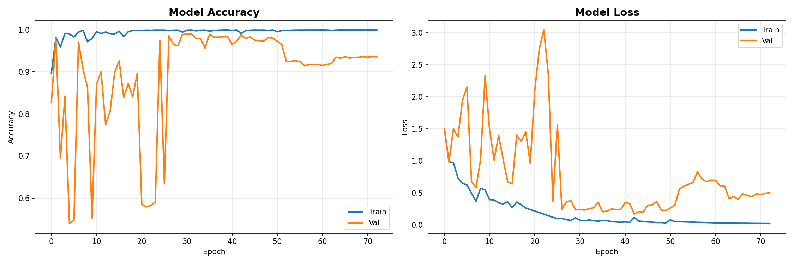
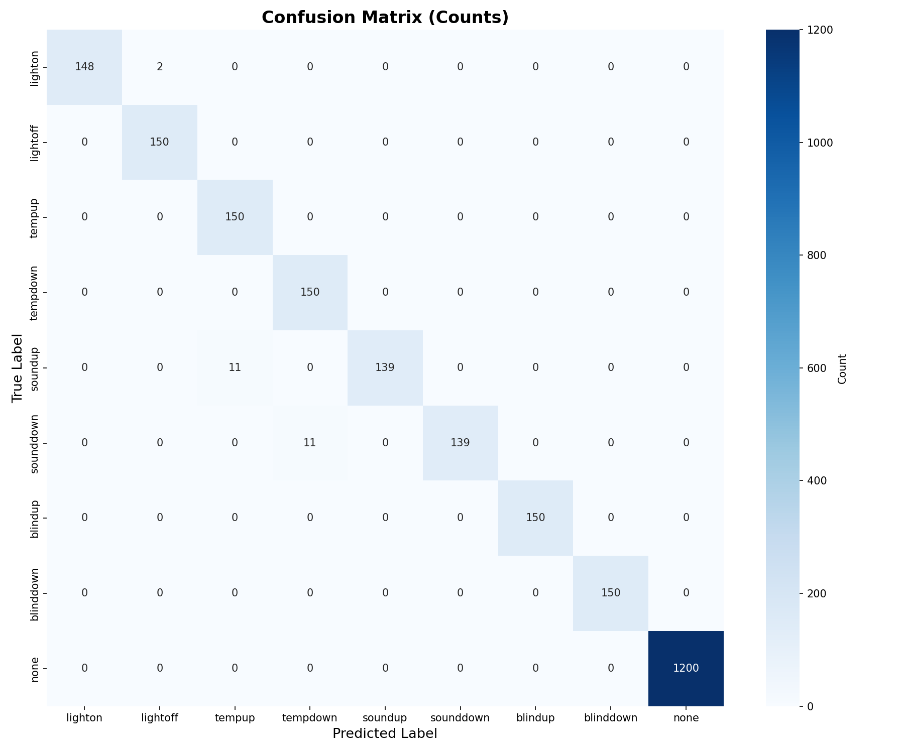
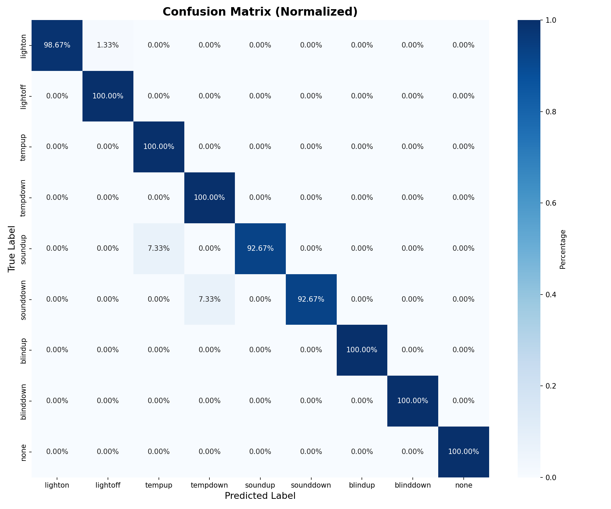
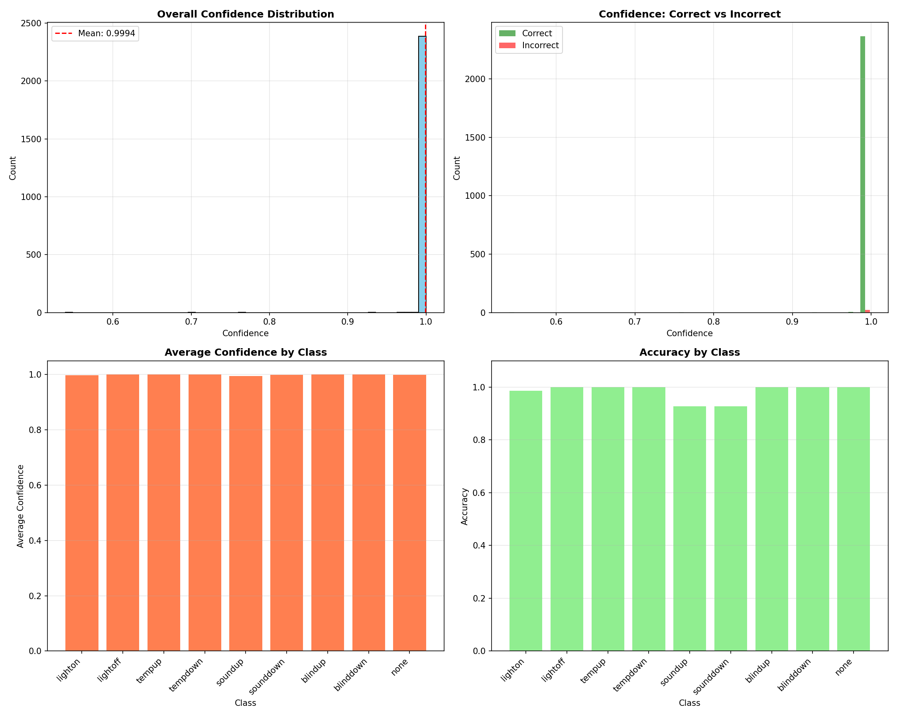

# 수화 기반 IoT 제어 (Sign Language IoT Control)

MediaPipe Holistic으로 손·얼굴·자세 랜드마크를 추출하고, Bidirectional LSTM + Multi-Head Attention 모델로 수화 8종을 인식해 IoT 기기(조명, 온도, 소리, 블라인드)를 제어하는 AIoT 캡스톤디자인 프로젝트입니다.

## 인식 클래스

| 인덱스 | 클래스 | 동작 |
|---|---|---|
| 0 | `lighton` | 조명 켜기 |
| 1 | `lightoff` | 조명 끄기 |
| 2 | `tempup` | 온도 올리기 |
| 3 | `tempdown` | 온도 내리기 |
| 4 | `soundup` | 소리 올리기 |
| 5 | `sounddown` | 소리 내리기 |
| 6 | `blindup` | 블라인드 올리기 |
| 7 | `blinddown` | 블라인드 내리기 |
| 8 | `none` | 수화가 아닌 일상 동작 |

## 입력 피처

한 프레임당 168차원(양손 126 + 얼굴 8개 포인트 24 + 어깨·팔꿈치·손목 18)을 추출하고, y 좌표는 어깨 중심 기준 상대 좌표로 변환합니다. 여기에 프레임 간 차이(velocity) 168차원을 더해 **30프레임 × 336차원** 시퀀스를 모델에 입력합니다.

## 성능

| 항목 | 값 |
|---|---|
| **실제 환경 테스트** | **95% (8개 클래스 × 10회 = 80회 중 76회 정답)** |
| Val Accuracy | 99.00% (epoch 31 모델 저장) |
| Train / Val 데이터 | 9,600 / 2,400 (증강 후) |
| 학습 / 검증 인원 | 4명 / 1명 (검증 인원은 학습에 미포함) |

Val 데이터에서 자주 틀린 경우는 `soundup → tempup`(11회), `sounddown → tempdown`(11회)이었습니다. 손 위치가 귀 옆과 목·얼굴 근처로 비슷한 동작들입니다.

### 학습 곡선



### 혼동 행렬





### 신뢰도 분포



## 설치

Python 3.8 ~ 3.10이 필요합니다. 모델 파일이 Keras 2.10으로 저장되어 있어 TensorFlow 2.10을 사용합니다.

```bash
pip install -r requirements.txt
```

## 학습된 모델 받기

모델과 정규화 파라미터는 용량 문제로 저장소에 포함하지 않았습니다. [Releases](../../releases)에서 두 파일을 받아 아래 위치에 넣어 주세요.

```
models/lstm_model.h5
data/augmented_data/normalization_params.npz
```

> `normalization_params.npz`가 없으면 정규화 없이 추론하므로 예측 결과가 틀어집니다. 반드시 모델과 함께 넣어 주세요.

## 사용 방법

### 서버 실행 (실제 사용)

```bash
python 7_server.py
```

1. 클라이언트가 TCP `9999` 포트로 영상 파일을 보냅니다. 먼저 파일 크기를 8바이트 big-endian 정수로 보내고, 이어서 파일 내용을 보냅니다.
2. 서버가 영상에서 수화를 인식합니다 (`server_support_with_postprocess.py`).
3. 인식 결과(클래스 이름, 예: `lighton`)를 클라이언트 IP의 UDP `8888` 포트로 보냅니다.

포트 번호는 `config.py`에서 바꿀 수 있습니다.

### 웹캠으로 실시간 테스트

```bash
python server_support_with_postprocess.py
```

`q`를 누르면 종료합니다.

## 클라이언트 하드웨어 구성

클라이언트는 Raspberry Pi 5에 웹캠과 출력 기기를 연결해 구성했습니다.

| 기기 | 용도 | 클래스 |
|---|---|---|
| Raspberry Pi 5 | 영상 촬영·전송, 결과 수신, 기기 제어 | - |
| 웹캠 | 수화 영상 촬영 | - |
| 단색 LED | 조명 | `lighton`, `lightoff` |
| 3색 LED | 온도 | `tempup`, `tempdown` |
| 피에조 부저 | 소리 | `soundup`, `sounddown` |
| 스텝모터 | 블라인드 | `blindup`, `blinddown` |

<!-- TODO: 소리(soundup/sounddown) 출력 기기가 피에조 부저가 맞는지 확인 필요 -->

동작 흐름은 다음과 같습니다.

```
[Raspberry Pi 5]  웹캠으로 수화 영상 촬영
       │  TCP 9999 (영상 파일)
       ▼
[서버]  7_server.py → 수화 인식
       │  UDP 8888 (클래스 이름, 예: lighton)
       ▼
[Raspberry Pi 5]  클래스에 맞는 기기 제어 (LED, 부저, 스텝모터)
```

> 영상을 촬영해 서버로 보내고 결과를 받아 IoT 기기를 제어하는 **클라이언트 코드는 이 저장소에 포함되어 있지 않습니다.** 위 통신 방식에 맞춰 클라이언트를 따로 구현해야 합니다.

## 직접 학습하기

`data/raw_videos/` 아래에 영상을 다음 구조로 넣습니다.

```
data/raw_videos/
├── train/
│   ├── person1/
│   │   ├── lighton/*.mp4
│   │   ├── ...
│   │   └── none/*.mp4
│   └── person2 ~ person4/
└── val/
    └── person5/
```

그다음 순서대로 실행합니다.

| 단계 | 파일 | 내용 |
|---|---|---|
| 1 | `1_extract_landmarks.py` | 영상에서 랜드마크 추출 (30프레임 × 168) |
| 1.5 | `1.5_visualize_landmarks.py` | 추출 결과를 이미지로 확인 (선택) |
| 2 | `2_normalize_and_add_velocity.py` | velocity 피처 추가 (168 → 336) |
| 3 | `3_check_data.py` | 데이터 개수·형태·NaN 검증 |
| 4 | `4_augment_data.py` | 데이터 증강 (속도 변화, 노이즈, 스케일, 회전 등) |
| 5 | `5_train_lstm.py` | 모델 학습 → `models/lstm_model.h5` |
| 6 | `6_evaluate_model.py` | Val 데이터로 평가 (혼동 행렬, 리포트) |

학습·증강 파라미터는 모두 `config.py`에 있습니다. 특정 GPU만 쓰려면 `gpu_config.py`의 주석을 풀어 주세요.

## 한계

### 직접 수집한 소규모 데이터

공개 데이터셋 없이 5명이 직접 촬영한 영상으로 학습했습니다. 증강 전 원본 시퀀스는 다음과 같습니다.

| | 수화 클래스당 | none |
|---|---|---|
| Train (4명) | 21 ~ 32개 | 4개 (영상 1개에 일상 동작 여러 개 포함) |
| Val (1명) | 3 ~ 13개 | 1개 |

Val 데이터도 Train과 같은 방식으로 증강했으며, 증강 후 Val 2,400개 중 50%(1,200개)는 none 원본 시퀀스 1개에서 생성한 것입니다.

### 데이터 부족으로 인한 과적합

원본 데이터가 적어 증강으로 약 20배를 늘렸지만, 학습 중 과적합이 많이 일어났습니다. 학습 곡선을 보면 다음과 같습니다.

- Train 정확도는 초반부터 거의 100%에 도달했습니다.
- Val 정확도는 처음 25 epoch 동안 54% ~ 99% 사이에서 크게 흔들렸습니다.
- Val loss는 epoch 42 전후에 가장 낮았고 이후 다시 올라갔습니다. epoch 50 이후에는 Val 정확도가 약 93%까지 떨어졌습니다.

Dropout, L2 정규화, Class Weight, Early Stopping을 적용했습니다. 최종 모델은 Val 정확도가 가장 높았던 epoch 31 시점을 저장한 것입니다.

## 파일 구조

| 파일 | 구분 | 설명 |
|---|---|---|
| `config.py` | 실제 사용 | 전체 공통 설정 |
| `gpu_config.py` | 실제 사용 | GPU / TensorFlow 환경 설정 |
| `1_` ~ `6_*.py` | 실제 사용 | 학습 파이프라인 |
| `7_server.py` | 실제 사용 | 수화 인식 서버 |
| `server_support_with_postprocess.py` | 실제 사용 | 서버 추론 모듈 (후처리 포함) |
| `server_support.py` | 실험용 | 후처리 도입 전 서버 추론 모듈 |
| `8_video_test_basic.py` | 실험용 | 영상 1개로 기본 추론 테스트 |
| `8_1_video_process.py` | 실험용 | sounddown/soundup 후처리 실험 |
| `test.py` | 실험용 | 데이터·모델 입력 차원 일치 확인 |
